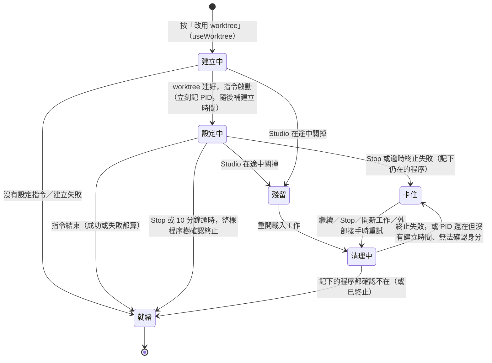

# Worktree setup 指令的生命週期

一張會寫檔的卡改到獨立 worktree 時，Studio 會建立 worktree，並執行專案設定的「worktree 建好後執行」指令（例如 `npm ci`）。
這段期間卡片處於「準備中」（`t.preparing`）。原則只有一條：**在 Studio 確認 setup 程序（含它開的子程序）已經結束之前，沒有任何入口能讓另一個寫入者進入同一個資料夾，也不能丟掉記錄這個程序的卡片。**

## 狀態

- **建立中／設定中**：卡片在登記表 `preparing` 裡有一筆「進行中」的紀錄，包含目標資料夾的路徑鍵與 setup 子程序。
- **殘留／卡住**：卡片 `preparing` 仍為 true，但沒有進行中的紀錄；程序身分存在 `t.worktree.setupProc`（cmd.exe）和 `setupLeft`（終止失敗時仍在的程序），失敗原因存在 `setupKillError`。工作保持暫停狀態，存檔後重開也會再接續清理。
- **清理中**：登記表裡有一筆 `leftover` 紀錄，正在比對與終止程序。
- 程序身分只認「PID＋建立時間＋執行檔」。沒有記到建立時間而 PID 還活著時，可能是被重用的 PID，所以**不終止**，只保持阻擋。
- 終止失敗後查詢程序資料也失敗時，終止結果裡已知的 PID 照樣記下，視為「身分未知」：活著就保持阻擋，消失才算結束。查詢在重試時失敗，也是保持阻擋。

## 入口 × 狀態

| 入口 | 建立中／設定中 | 清理中 | 卡住 |
|---|---|---|---|
| 排程開卡（pump） | 不開始 | 不開始 | 不開始 |
| 自動收尾（所有卡都結束，例如前置卡失敗） | 不收尾，setup 結束後再收尾 | 不收尾 | 不收尾 |
| 交接、改唯讀、改派、撤出成員 | 拒絕 | 拒絕 | 拒絕 |
| 外部接手：同一個資料夾或主專案 | 暫停工作，等它結束；結束後仍阻擋（例如等待中 Stop 終止失敗）就拒絕 | 等它；失敗就拒絕 | 先重試；失敗就拒絕 |
| 外部接手：別的 worktree | 不等 | 不等 | 不等（仍會順便重試） |
| 暫停 | 指令繼續跑，卡片不會開始 | 同左 | 同左 |
| Stop | 先暫停、終止並確認；失敗就保持暫停並拒絕 Stop | 等它；失敗就拒絕 | 先重試；失敗就拒絕 |
| 繼續 | 可以（卡片等準備完成） | 等它；失敗就拒絕 | 先重試；失敗就拒絕 |
| 開新工作 | 拒絕（請等或按 Stop） | 等它；失敗就拒絕 | 先重試；失敗就拒絕 |
| 從歷史紀錄繼續另一件工作（會換掉目前工作） | 拒絕（請等或按 Stop） | 等它；失敗就拒絕 | 先重試；失敗就拒絕 |
| 關閉專案 | 拒絕 | 拒絕 | 拒絕 |
| 再按一次「改用 worktree」 | 拒絕 | 拒絕 | 拒絕 |
| 工作已停止或正在收尾時按「改用 worktree」 | 拒絕 | — | — |
| Studio 重開 | 轉為殘留，進入清理中 | 轉為殘留，進入清理中 | 轉為殘留，進入清理中 |

## 並發

- **開新工作與繼續共用一把「啟動中」鎖**：它們都在檢查完狀態之後等待（殘留清理、成員停下），同一個專案同時只能有一個在跑，第二個請求直接拒絕。
- **繼續在等待後再檢查一次**：等待期間工作若被 Stop 或換掉，就放棄繼續，不會把已停止的工作重新啟動。
- **Stop 在 setup 確認結束之前不會標成已停止**：一直保持暫停，因為只有暫停中的工作在重開後會被載入，卡片才不會遺失。
- **終止失敗當下就轉為「卡住」**：不等 cmd 自己結束（它可能永遠不結束），等待中的 Stop、接手、建立 worktree 的請求都立刻得到失敗結果。cmd 之後自己結束時，舊流程晚到的結果不會寫入卡片的任何欄位，既不解除也不重新阻擋，也不會產生可刪除的忽略檔清單，所以蓋不掉重試留下的保守標記（空清單）。解除只靠重試時確認程序都不在。10 分鐘逾時走同一條終止路徑。
- **轉為卡住只做一次、大家共用**：Stop／逾時的終止與 cmd 結束後的收尾可能同時觸發；第二個呼叫會等第一次把殘留程序寫進紀錄，登記在那之前不移除，所以接手、開新工作不會看到「卡住但沒有程序紀錄」的卡片，也不會有晚到的轉換把紀錄寫回已解除的卡片。
- **每次終止失敗都補記殘留程序**：重試時終止再失敗，這次回報仍存活的程序（含新發現的子程序）會先合併進紀錄再拒絕；查不到程序資料時只記 PID。
- **逾時等同 Stop**：被 10 分鐘上限終止的 setup，和按 Stop 一樣，它留下的檔案清理時都不刪。
- **輸出不設上限也不會被 Node 中途終止**：setup 用 `spawn` 執行，只保留輸出的最後一段；舊做法用 `execFile` 時，輸出超過 16 MiB，Node 只會殺掉 cmd.exe，它開的子程序會被留下。
- 外部接手、繼續、Stop 和開新工作同時等待同一筆清理時，共用同一個 promise，不會重複終止。
- **外部接手不看等待的結果，而是重新檢查狀態**：等待結束後檢查一次、取鎖前檢查一次，寫入權寫入的同一個同步區段裡再檢查一次（中間沒有等待）。被拒絕時，為這次接手取的鏡像鎖會一併釋放。

## 已知限制

- 「仍在的程序」以 Studio 終止當下看到的程序樹為準；指令在那之前就已脫離的孫程序追蹤不到。
- 10 分鐘逾時與 Stop 都經過 `killSetup()`；測試用環境變數 `STUDIO_SETUP_LIMIT_MS` 把上限縮短，兩條路徑都有覆蓋。
